# 🚀 Awesome Application Deployment & Management

  <strong>Curated Directory of Unified Endpoint Management (UEM), Mobile Device Management (MDM), Remote Monitoring &amp; Management (RMM), and Automated Software Deployment Tools</strong>

  
  
  
  
  

  <em>Last updated: October 2026 | Maintaining transparency in enterprise IT fleet operations and self-hosted automation</em>

---

## 📖 Introduction & Scope

Welcome to the definitive, SEO-optimized knowledge base and guide for **Application Deployment & Device Management**. Whether you are a system administrator, DevOps architect, Managed Service Provider (MSP), or enterprise IT director, this curated repository simplifies your tooling decisions across cloud-native **Unified Endpoint Management (UEM)**, **Mobile Device Management (MDM)**, **Remote Monitoring and Management (RMM)**, and **Configuration Management Infrastructure**.

These solutions empower organizations to:
- 📦 **Automate Software Distribution**: Silent installations, custom packaging, dependency management, and rollback mechanisms.
- 🛡️ **Orchestrate Patch Management**: Zero-day OS updates, third-party software patching, and vulnerability remediation across Windows, macOS, and Linux fleets.
- 🔒 **Enforce Zero-Trust & Compliance**: BitLocker/FileVault encryption enforcement, CIS/NIST benchmarks, identity access policies, and remote wipe capabilities.
- 🖥️ **Remote Troubleshooting & Diagnostics**: Hardware telemetry, osquery forensics, live terminal access, and unattended remote desktop control.

---

## 📑 Table of Contents

- [📊 Sector Overview & Market Dynamics](#-sector-overview--market-dynamics)
- [☁️ SaaS & Hosted Enterprise Platforms](#️-saas--hosted-enterprise-platforms)
- [⚡ Open-Source GitHub Projects](#-open-source-github-projects)
- [🤝 How to Contribute](#-how-to-contribute)
- [💖 Support](#-support)
- [⭐ Star History](#-star-history)
- [⚖️ Disclaimer](#️-disclaimer)

---

## 📊 Sector Overview & Market Dynamics

The global Unified Endpoint Management (UEM) and software deployment automation sector is valued between **$7.5B and $8.5B in 2025** and projected to surpass **$10B+ by 2026**, registering a rapid double-digit Compound Annual Growth Rate (~16%–23% CAGR).

### 📈 Market Structure: Moderately Concentrated
- **Enterprise Core (Concentrated Tier)**: Mega-cap tech titans—most notably **Microsoft** (Microsoft Intune) alongside **Omnissa** (VMware Workspace ONE / Horizon), **ManageEngine** (Zoho Corp), and **Ivanti**—capture the lion's share of enterprise revenue due to extensive product suites, deep enterprise agreements, and cloud identity bundling (e.g., Microsoft 365 E3/E5).
- **Specialized & MSP Innovators (Fragmented Tier)**: A competitive tier of agile providers excels in platform-specialized and MSP operations. **Jamf** and **Kandji** capture high-margin Apple macOS/iOS fleets, while **NinjaOne** and **JumpCloud** capture massive market share across high-velocity mid-market IT and multi-tenant MSP workflows.

---

## ☁️ SaaS & Hosted Enterprise Platforms

> Evaluated by market scale and enterprise footprint (descending order). All pricing models and evaluation limits are verified to assist procurement teams.

| Product | Focus & Description | Valuation / Revenue Scale | Starting Pricing Tier | Free Tier & Evaluation Limit |
| :--- | :--- | :--- | :--- | :--- |
| **[Microsoft Intune](https://www.microsoft.com/en-us/security/business/microsoft-intune)** | 🪟 🍏 🐧 Cloud-native unified endpoint management and cross-platform mobile device management for enterprise ecosystems. | **$3.1T+ Market Cap** (Microsoft) / ~$245B+ Annual Revenue | **$8.00/user/month** (Plan 1, annual commitment); Plan 2 add-on at **+$4.00/user/month**; Intune Suite at **+$10.00/user/month**; bundled into Microsoft 365 E3/E5. | **30-day free trial** (up to 25 full user licenses with full administrative feature access); no permanent free plan. |
| **[ManageEngine Endpoint Central](https://www.manageengine.com/products/desktop-central/)** | 🛡️ Comprehensive UEM suite incorporating OS patching, third-party software deployment, asset management, and mobile enrollment. | **~$12.5B Valuation** (Zoho Corp) / ~$1B+ Annual Revenue | **$1.09/endpoint/month** ($6,545/year starting tier for 500 endpoints, Professional Edition); Enterprise tier starts at $1.37/endpoint/month. | **Free Edition permanently free for up to 25 endpoints** (unrestricted core features); also provides a **30-day free trial** for unlimited endpoints. |
| **[NinjaOne](https://www.ninjaone.com/)** | ⚡ High-velocity IT operations and RMM platform featuring rapid patch automation, remote access, ticketing, and endpoint visibility. | **$12.3B Valuation** / ~$500M+ ARR | **$1.50–$3.75/device/month** (starting tier ~$3.75/device/month for small fleets ≤50 endpoints; volume scales down to ~$1.50/device/month for 10,000+ endpoints). | **14-day free trial** (unlimited features, scripts, and full remote control on test devices); no permanent free plan. |
| **[VMware Workspace ONE](https://www.vmware.com/products/workspace-one.html)** | 🌐 Digital workspace and enterprise UEM engine (Omnissa) providing multi-OS zero-trust access, lifecycle deployment, and analytics. | **$4.0B Valuation** (Omnissa / KKR) / ~$1.5B ARR | **$117.99/user/year** (~**$9.83/user/month** list via CDW for Standard Shared Cloud); Education on-premise licensing starts at $95.75/device/year. | **30-day free trial** (capped evaluation setup for up to 100 test devices); no permanent free tier. |
| **[JumpCloud](https://jumpcloud.com/)** | 🔑 Open directory platform combining cloud IAM, Single Sign-On (SSO), multi-factor authentication, and cross-OS MDM device control. | **$2.6B Valuation** / ~$150M–$200M ARR | **$11.00/user/month** (Starter Package, billed annually); Device-only management package starts at **$9.00/device/month**; Plus tier is **$21.00/user/month**. | **30-day free trial** (unlimited access to full directory, identity, and device features); legacy accounts maintain 10 users / 10 devices. |
| **[Ivanti Neurons](https://www.ivanti.com/)** | 🤖 AI-powered endpoint management, autonomous vulnerability remediation, asset discovery, and compliance orchestration. | **~$2.0B Valuation** / ~$1.0B–$1.5B Annual Revenue | **£10.89/device/year** (~**$14.00/device/year** or ~$1.17/device/month for Patch Management Cloud starting tier at 1,500 devices); Workspace Cloud at £7.96/device/year. | **30-day vendor-assisted evaluation trial** (or product-specific trials up to 60 days / 50 seats upon enterprise sales approval); no permanent free tier. |
| **[Jamf Pro](https://www.jamf.com/products/jamf-pro/)** | 🍎 Gold-standard Apple ecosystem device management with deep zero-touch deployment, macOS packaging, and configuration profiles. | **~$1.7B Market Cap** (NASDAQ: JAMF) / ~$625M Annual Revenue | **$3.33/device/month** for iOS/iPadOS/tvOS (billed annually); **$7.17/device/month** for macOS (billed annually). | **14-day free trial** (full access to Apple MDM enrollment workflows and policy engines); no permanent free tier. |
| **[Kandji (now Iru)](https://www.kandji.io/)** | 🍏 Next-generation Apple device management featuring automated compliance blueprints, vulnerability patching, and Prism telemetry. | **$850M Valuation** / ~$60M ARR | **$3.20/device/month** (buyer-reported macOS entry tier at commit minimums; AWS Marketplace baseline contract starts at **$25,000/year**). | **14-day free trial** (capped at up to 10 evaluation endpoints with sales onboarding); no permanent free tier. |
| **[PDQ Deploy](https://www.pdq.com/)** | 🪟 Windows-focused silent installer and patch automation engine paired with inventory discovery for on-premises sysadmins. | **~$300M Valuation** / ~$45M–$60M Annual Revenue | **$1,657.50/admin/year** (~**$138.13/admin/month**, starting package bundle for PDQ Deploy & Inventory). | **Permanent Free Mode** (unlimited target endpoints and custom package creations forever; restricts pre-built package library access); Enterprise full trial is **14 days**. |

---

## ⚡ Open-Source GitHub Projects

> Community-driven, self-hosted, and transparent infrastructure tools. Sorted by **GitHub Stars_Count** (descending). Badges link directly to stargazer communities.

- **[Ansible](https://github.com/ansible/ansible)**   
  🤖 **Agentless Configuration Management & Application Deployment Engine.** Simple, agentless automation framework utilizing YAML playbooks to configure bare-metal, virtualized, and cloud systems across Linux, Windows, and network infrastructure.

- **[Salt](https://github.com/saltstack/salt)**   
  ⚡ **High-Speed Event-Driven Orchestration & Remote Execution.** Scalable Python-based systems management engine with asynchronous messaging for near-instant execution and state configuration across massive enterprise server environments.

- **[Chef](https://github.com/chef/chef)**   
  👨‍🍳 **Infrastructure-as-Code Automation & Policy Management.** Powerful Ruby-based DSL and recipe engine that turns infrastructure into code to achieve consistent, repeatable application delivery and compliance.

- **[Puppet](https://github.com/puppetlabs/puppet)**   
  🎭 **Declarative Configuration Management & State Enforcement.** Established declarative manifest automation system designed for enforcing consistent system configuration states, continuous drift control, and enterprise compliance.

- **[MeshCentral](https://github.com/Ylianst/MeshCentral)**   
  🕸️ **Self-Hosted Web-Based Remote Computer & Device Management Platform.** Complete remote management web application with agent-based control, file transfer, remote terminal access, Intel AMT hardware-level KVM management, and multi-tenant grouping.

- **[Fleet](https://github.com/fleetdm/fleet)**   
  🔍 **Open-Source osquery Fleet Management & Programmable MDM.** Comprehensive device management and security platform built upon osquery, delivering real-time telemetry, automated compliance checking, and zero-trust policy enforcement across macOS, Windows, and Linux.

- **[Tactical RMM](https://github.com/amidaware/tacticalrmm)**   
  🎯 **Self-Hosted Remote Monitoring & Software Deployment Platform.** Full-featured open-source RMM built with Django, Vue, and Go. Features agent-based endpoint management, automated Windows patch deployment, script execution, alert automation, and remote desktop access without per-device SaaS fees.

- **[Munki](https://github.com/munki/munki)**   
  🐵 **Web-Server Driven Software Installation & Packaging for macOS.** Robust client-server toolset allowing macOS administrators to manage software installations, updates, and removals using standard web server protocols and native Apple packages.

- **[Foreman](https://github.com/theforeman/foreman)**   
  🏗️ **Complete Lifecycle Management for Physical & Virtual Servers.** Bare-metal provisioning, configuration orchestration (integrating Ansible, Puppet, and Salt), and patch management engine across enterprise hybrid-cloud Linux ecosystems.

- **[MicroMDM](https://github.com/micromdm/micromdm)**   
  📱 **Modular Apple Mobile Device Management Protocol Server.** Minimalist, composable Go-based MDM protocol implementation providing native Apple MDM command processing, device enrollment, and configuration profile management for macOS and iOS.

- **[FOG Project](https://github.com/FOGProject/fogproject)**   
  💿 **Open-Source Network Computer Cloning & PXE Deployment.** Free and open-source network boot and imaging server facilitating PXE boot, automated disk cloning, snap-in software deployments, and printer management across Windows and Linux fleets.

- **[AutoPkg](https://github.com/autopkg/autopkg)**   
  📦 **Automated Packaging and Software Distribution Framework for macOS.** Python-based recipe framework automating the download, preparation, and packaging of macOS software releases for distribution into Munki, Jamf Pro, and other systems.

- **[Nudge](https://github.com/macadmins/nudge)**   
  🔔 **Enforce macOS System Updates via Gentle User Notifications.** Native Swift-built tool enabling administrators to prompt and encourage users to install macOS software updates prior to enforcement deadlines.

- **[Rudder](https://github.com/Normation/rudder)**   
  📋 **Continuous Configuration Management & Regulatory Compliance System.** Real-time configuration management solution ensuring servers remain continuously compliant over time, featuring audit trails, drift detection, and automated policy remediation.

---

## 🤝 How to Contribute

Contributions make the open-source and IT community stronger! To contribute:

1. 🍴 **Fork the Repository** on GitHub.
2. 🌿 **Create a Feature Branch** (`git checkout -b feature/awesome-tool`).
3. 📝 **Add or Update Entries** in `README.md` following the existing format:
   - Provide accurate links and factual, neutral descriptions.
   - For SaaS tools: Include specific pricing tiers, valuation/scale, and exact trial/free-tier limits.
   - For open-source tools: Include the stargazers badge and maintain star-count sort order.
4. 🚀 **Commit & Push** (`git commit -m 'Add ToolName'`).
5. 🔀 **Open a Pull Request** with a brief summary of the added tool.

---

## 💖 Support

If you found this curated list helpful for your IT infrastructure, team research, or procurement evaluations, please consider showing your support:

- ⭐ **Star this repository** to help others discover it on GitHub.
- 🍴 **Fork and share** with fellow sysadmins, DevOps engineers, and MSPs.
- ☕ **Sponsor the project**: If you'd like to fuel further maintenance and curated open-source projects, you can buy a coffee or sponsor via the [GitHub Sponsors Dashboard](https://github.com/sponsors/ishandutta2007).

Your support is deeply appreciated and keeps community documentation vibrant! 🙌

---

## 📈 Star History

---

## ⚖️ Disclaimer

- This repository is a **community-curated guide** intended for informational and educational purposes — not a commercial endorsement.
- **SaaS Pricing Models Differ**: Solutions like Microsoft Intune and JumpCloud utilize per-user licensing, whereas Jamf Pro, Kandji, and NinjaOne utilize per-device/endpoint models. Assess your specific fleet metrics (user-to-device ratio) prior to contract commitments.
- **Apple Fleet Management Cost Premium**: macOS/iOS specialized tools (Jamf Pro, Kandji) reflect specialized ecosystem fees compared to unified suites.
- **Open-Source Operational Costs**: Self-hosting tools like Tactical RMM, MeshCentral, and Foreman eliminates per-device license costs but requires server resources, backup strategies, and maintenance overhead.

---

  Built with ❤️ for IT administrators, MSPs, and DevOps professionals managing modern device ecosystems.

